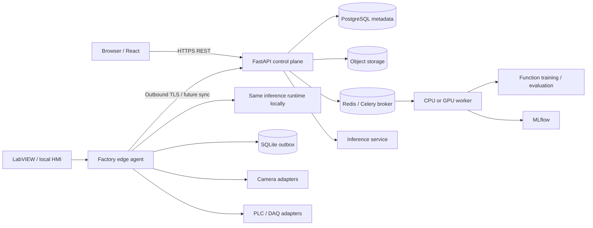

# Architecture and boundaries

Diagram describes the target architecture; only the foundation documented in README
is implemented. Local infrastructure does not automatically implement these connections.

## Keep the three-person team effective

Use one modular API, not dozens of business microservices. Separate inference because
GPU/memory/latency are different; separate workers because jobs are long-running;
separate edge because inspection must survive internet loss. Keep shared runtime
code small in packages/core; heavyweight AI dependencies stay out of web/API code.
The initial Python environment is shared for development simplicity, with GPU extras
added by Akash only when required. Split production image dependencies at packaging time.

## Teaching path

Presigned upload → immutable object → dataset snapshot → annotate → freeze grouped
train/validation/test splits → job row plus reliable enqueue → train → evaluate against
parent on locked test set → candidate → authorised approval → signed package → deployment.
The job row is the durable source of status; Redis is delivery infrastructure. Plan
idempotency, cancellation, leases/retries and transactional outbox before real training.
Current Celery ping is only an infrastructure check.

## Factory path

Trigger with sequence → capture → model observation → approved rule evaluation →
validated PLC handshake → local durable result → background sync. Reconcile result IDs
idempotently after reconnection. Bound queue size and define disk-full behavior.
Only a fresh, correct-sequence, valid result may permit PASS. Timeouts, missing results,
model errors, stale responses, unlicensed packages and sequence mismatches must hold or
follow the commissioned failure policy. The included safe_decision helper is simulation
fallback, not a complete rule engine or certified control function.

## Tenancy and security

Resolve tenant membership from verified user/device identity. Scope every customer
query, object-storage key, worker job and audit entry by organisation; reject cross-tenant
references even when IDs exist. Add tenant isolation tests when tenant resources are added.
Organisation itself is the root and has id, not a redundant org_id.
Never ship local demo credentials, expose internal inference publicly, or use a request
header as trusted identity. Password sign-in issues a database-backed browser session.
Device certificates and tenant resource endpoints remain planned.

## Data ownership

PostgreSQL: tenant/access, projects/assets, templates/functions/configurations,
classes, datasets/annotations, jobs, models/deployments, results, rules, audits.
Object storage: immutable images, exports, model packages, reports.
MLflow: reproducible experiments, not the authorisation source of truth.
SQLite: future factory outbox. Time-series store: add after sensor volume is measured.

Use version columns for optimistic concurrency; composite tenant/resource foreign keys
or equivalent checks prevent cross-tenant associations. Store model/dataset provenance,
configuration version, sequence and device identity with every production result.

## Contract policy

packages/schemas contains the public wire contracts. api.json is the checked-in OpenAPI
snapshot generated from FastAPI's typed definitions. inference.json covers the separate
AI service, including its current model-unavailable contract. `make contracts` fails on drift.
At feature design time, review the contract before merging consumers; update types and
snapshot together. JSON schemas are independently versioned. v1 now distinguishes
execution_status from decision; the obsolete starter's OK/NOT_OK format is archived.
Typed per-function payloads, edge commands and generated TS clients remain future work.

## Environments

Local runs PostgreSQL 16, Redis 7, API, inference and workers through root compose.yaml.
The frontend runs separately by default. MinIO and MLflow are optional future-AI tools
in infra/compose.ai-tools.yaml. All published development ports bind to loopback.
Local HTTP is development-only;
production requires TLS, real identity, managed secrets and measured capacity.
No cloud provider, Kubernetes cluster or paid service is provisioned by this scaffold.

Detailed table boundaries and tenancy invariants: [Data model](DATA_MODEL.md).

Implementation details and target reliability mechanisms: [Distributed system](DISTRIBUTED_SYSTEM.md).
