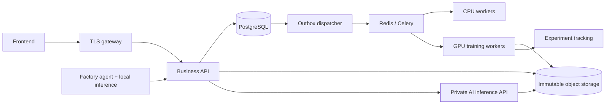

# Distributed system design

## Working foundation and target system

Implemented: frontend HTTP service module; layered static catalogue; API liveness and
DB readiness; separate unavailable-model AI API; Celery health job over Redis; PostgreSQL
migrations and diagnostic functions; Compose definitions and automated checks.

Not implemented: identity, tenant resource CRUD, durable jobs/outbox, training,
model registry approvals, signed packages, cloud infrastructure, production telemetry
or durable factory sync. Diagrams below are the target design, not evidence of working features.

## Boundaries and ownership

| Component | Owns | Must not own |
|---|---|---|
| Frontend | Screens, HTTP calls, loading/error state | Secrets, authorisation decisions |
| Business API | Verified identity, access, use cases, approval, metadata | GPU training or hardware control |
| PostgreSQL | Durable business state and integrity | Large images or weight blobs |
| Object storage | Immutable data and model artifacts | Approval authority |
| Redis/Celery | Work delivery and transient coordination | Durable job truth |
| Worker | A bounded leased job attempt | Trust of unverified message tenant IDs |
| AI API | Model observation and runtime health | Customer access policy or final PLC permission |
| Edge agent | Trigger sequence, local rule evaluation, durable local result | Dependence on cloud for each inspection |

Use separate deployable processes for these resource/failure boundaries. Keep related
business use cases in one modular API. Additional domain services need measured scale,
isolation or ownership justification. Docker containers alone do not solve distributed
consistency. Services communicate through versioned contracts, not another service's
Python internals or direct cross-owner table writes.

## Request and transaction path

Controller validates the HTTP contract and verified identity. The service checks
membership/role, resolves tenant-scoped dependencies and starts a unit of work.
Repository interfaces require an explicit tenant context. Implementations filter
reads and writes by organisation; composite foreign keys prevent cross-tenant links.
Commit once per business use case. Map conflicts and domain errors to a stable error
envelope without leaking SQL, credentials or cross-tenant existence.

Store idempotency key + organisation + operation + request digest + response reference
in a unique database constraint. A retry with a different request digest is a conflict.
Use version columns for optimistic locking; include expected version on updates.
A distributed lock does not replace database constraints.

## Durable asynchronous jobs (next implementation)

Create `jobs` with organisation, project, function, dataset snapshot, configuration
version, job type, status, attempt, lease expiry, cancellation request, timestamps,
progress, error code and artifact references. Create `outbox_events` with unique event
ID, organisation, event type/version, aggregate ID, payload, creation/publication time
and delivery attempt count. Customer references must be validated before insertion.

1. One PostgreSQL transaction inserts job + outbox event; return 202 and the job URL
   only after commit. Do not enqueue first and hope the database transaction succeeds.
2. Dispatcher claims a bounded batch using `FOR UPDATE SKIP LOCKED`, publishes job/event
   references, then marks publication. A crash between publishing and marking can duplicate
   delivery; publication markers cannot guarantee exactly-once processing.
3. Worker reloads the tenant-scoped job from PostgreSQL, verifies state and claims a lease
   with an atomic transition. Duplicate terminal jobs do nothing. Concurrent attempts cannot
   both own the lease. Never infer trusted context from a Redis message alone.
4. Execute outside a long database transaction. Renew the lease, checkpoint progress and
   observe cancellation. Write artifacts under immutable attempt-specific object keys.
5. Finalise only if attempt/lease still match. An expired worker cannot overwrite a newer
   attempt. A reconciler handles abandoned leases and unpublished events.
6. API polling reads PostgreSQL; optional streaming notifies but never replaces durable state.

Suggested state machine: `queued -> running -> succeeded | failed | cancelled`.
Retry is an explicit new attempt, bounded by policy; cancellation request and cancelled
state are distinct. Approval belongs to a model candidate, not a successful job status.
Test crash boundaries, duplicate delivery, stale leases, cancellation, broker loss and
cross-tenant references before exposing training jobs.

## Queues, timeouts and capacity

Current queue: `platform`, for health tasks only. Future queues: `training.cpu`,
`training.gpu`, `evaluation`, `exports`. Configure each task's route, time limit,
resource limits and visibility timeout together. GPU concurrency follows measured
VRAM requirements; do not send training into the current general worker.

Retry transient storage/network failures with exponential backoff and jitter; bound
attempts and elapsed time. Validation errors, missing permission and incompatible
artifacts fail without retry. Keep failed job records and controlled replay tooling.
Define per-tenant quotas, queue depth/age alarms, upload limits and job admission
before allowing expensive work. Measure limits rather than claiming an arbitrary scale.

Cloud inference calls need total deadlines, bounded concurrency and transport reuse.
Validate returned function/model/configuration identity and sequence; reject invalid,
stale or mismatched data. No retries that can apply a stale factory result. Model
unavailability, timeouts and invalid results must remain HOLD in the control path.
The existing `safe_decision` helper remains a simulation fallback, not a commissioned
safety system. Never give browser clients a private inference URL.

## Observability and failure behaviour

Introduce request/trace IDs across HTTP, outbox and worker attempts. Structured logs
include service, operation, job, attempt and non-sensitive tenant identifiers; do not
log images, tokens or raw payloads. Measure latency/error rate, database saturation,
queue age, retries, GPU memory, model rejection and edge sync lag. Logging/tracing
exporters are future work; do not claim they exist because a diagram includes them.

API liveness proves the process runs. Current readiness checks the migrated DB; it
should not require a loaded AI model to serve the public catalogue. At the job
admission boundary, fail or defer work predictably when required dependencies are down.
Keep timeouts on every network hop. Document manual recovery and measure it.

Factory operation survives cloud failure through local approved packages, a bounded
SQLite outbox and idempotent result sync. Those are target components. Bench-test
freshness, sequence mismatch, expired licences, disk-full and hardware disconnect
before actual PLC outputs. Keep certified emergency interlocks outside this platform.
