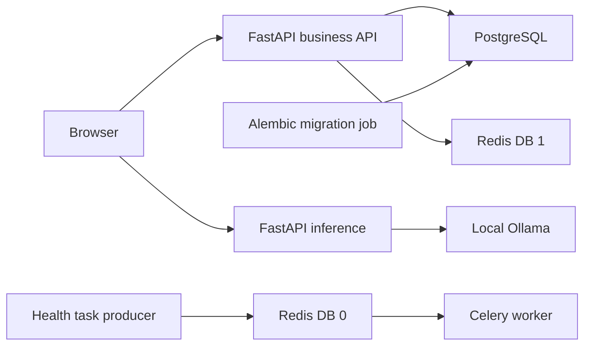

# Local backend code map

Start in [deployment/docker-compose](../../deployment/docker-compose/README.md).
The services are separate processes on a Compose network. FastAPI serves HTTP,
Uvicorn runs the ASGI application, and Celery consumes asynchronous jobs. PostgreSQL
holds durable data. The Redis broker and cache use separate logical databases on a
single local Redis server.

| Node.js concept | VI WebSync Python equivalent |
|---|---|
| Express application startup | [bootstrap.py](../../services/api/src/vi_api/bootstrap.py) creates the FastAPI app, installs error handlers, and includes routers. Uvicorn loads `vi_api.bootstrap:app`. |
| Express router and `router.post()` | A FastAPI `APIRouter` registers typed controller methods. `add_api_route(..., methods=["POST"])` binds the HTTP method and publishes an OpenAPI contract. |
| Inversify bindings | [container.py](../../services/api/src/vi_api/container.py) is the composition root. FastAPI `Depends` resolves providers. Providers construct use cases and inject repositories implementing domain `Protocol` interfaces. Tests can replace a provider through `app.dependency_overrides`. |
| Controller and validation | [DemoExamplesController](../../services/api/src/vi_api/interfaces/http/controllers/demo_examples.py) parses typed route/query parameters. [read_jpeg](../../services/api/src/vi_api/interfaces/http/validation.py) checks content type, size, and JPEG framing. |
| Service or use case | [CreateDemoExample](../../services/api/src/vi_api/app/demo_examples/create_demo_example.py), [ListDemoExamples](../../services/api/src/vi_api/app/demo_examples/list_demo_examples.py), and [GetDemoExampleImage](../../services/api/src/vi_api/app/demo_examples/get_demo_example_image.py) use the repository interface independently of FastAPI and SQLAlchemy. |
| Data access | [DemoExampleRepository](../../services/api/src/vi_api/domain/demo_examples/repository.py) defines the contract. [PostgresDemoExampleRepository](../../services/api/src/vi_api/infrastructure/repository/demo_examples.py) contains parameterized SQL and local image storage. [session.py](../../services/api/src/vi_api/infrastructure/database/session.py) configures the async SQLAlchemy engine and session factory. |
| Error middleware | [errors.py](../../services/api/src/vi_api/interfaces/http/errors.py) maps request exceptions to `{"error":{"code":"...","message":"..."}}`. Demo codes include `demo_disabled`, `example_image_not_found`, `unsupported_image_type`, `image_too_large`, and `invalid_image`. FastAPI parameter errors use `validation_error`. |

## Service connections



The frontend development proxy forwards browser requests to the appropriate API.

## What happens when you save an example

1. The browser sends a JPEG, physical part ID, and operator label to
   `POST /api/v1/demo/examples`.
2. FastAPI resolves the repository provider and creates `CreateDemoExample`.
   The controller reads the bounded JPEG and passes it to the use case.
3. The repository writes the JPEG to the local volume, then inserts its UUID,
   part ID, and label in PostgreSQL. The transaction returns the metadata as a
   typed response. Listing reads the table. The image endpoint verifies that
   the row exists before serving the matching file.
4. Automatic inspection has its own HTTP path. Vite proxies
   `POST /api/v1/demo/inspect` to [vi_inference.main:app](../../services/inference/vi_inference/main.py).
   The [inference route](../../services/inference/vi_inference/demo_inspection.py)
   calls local Ollama synchronously and converts a validated model response to
   PASS, FAIL, or HOLD. Saving examples and clicking Inspect are independent.

## Database files and local queries

| Object | Where it lives |
|---|---|
| `public.organisations` | [0001_organisations.py](../../database/migrations/versions/0001_organisations.py) |
| `platform` schema and ten diagnostic functions | [0002_diagnostics.py](../../database/migrations/versions/0002_diagnostics.py) applies [0002_diagnostics.sql](../../database/functions/0002_diagnostics.sql). |
| `public.demo_examples` | [0003_demo_examples.py](../../database/migrations/versions/0003_demo_examples.py) |
| `public.alembic_version` | Managed by Alembic. The `migrate` Compose service runs `alembic -c database/alembic.ini upgrade head` before the API and worker start. |

From `deployment/docker-compose`, open the local SQL shell with:

```bash
docker compose exec postgres sh -c 'psql -U "$POSTGRES_USER" -d "$POSTGRES_DB"'
```

Then run:

```sql
\dn
\dt public.*
\d public.demo_examples
\df platform.*
SELECT platform.usp_schema_version();
SELECT * FROM platform.usp_table_sizes();
SELECT id, part_id, label, created_at FROM public.demo_examples ORDER BY created_at DESC;
```

For executable migration SQL, use
`docker compose run --rm migrate alembic -c database/alembic.ini upgrade head --sql`.
See the [database guide](../../database/README.md) for pgAdmin and the full function list.

## Redis cache and job queue

- **Cache, database 1.** The catalogue provider wraps the JSON repository in
  [CachedCatalogueRepository](../../services/api/src/vi_api/infrastructure/cache/catalogue.py).
  The adapter reads a versioned key, validates the cached payload, and stores the
  public catalogue for 60 seconds on a miss. If Redis fails, the API reads the JSON
  catalogue. No customer photos, examples, or tenant data are cached.
- **Broker, database 0.** [worker/app.py](../../services/worker/worker/app.py) configures
  Celery with `REDIS_URL`, registers the `vi.health.ping` task, and routes it to the
  `platform` queue. [worker/enqueue.py](../../services/worker/worker/enqueue.py) calls
  `ping.delay()`. Celery publishes JSON to Redis and a separate worker process consumes
  the task. Worker logs record completion. This smoke task is the current queue
  workload. The queue has no result backend.
- **Customer jobs.** Durable training jobs, leases, retry tracking, and the
  transactional outbox are design work. The local demo does not put image capture
  or inspection on the job queue. Before using Redis for both roles in production,
  give cache and broker independent deployments and capacity limits.
